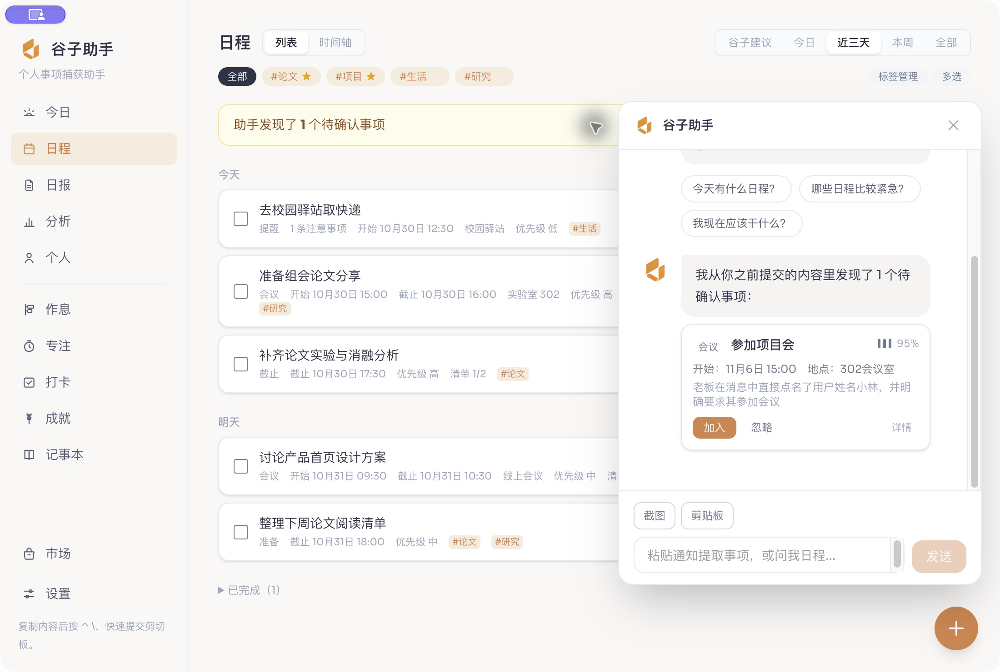

<p align="center">
  
</p>

<h1 align="center">谷子助手 Guzi Assistant</h1>

<p align="center">
  <b>从聊天、截图和剪贴板里找出你的待办，你确认后才加入日程。</b><br />
  本地优先的 macOS 个人事项捕获助手
</p>

<p align="center">
  <a href="https://a.guzilab.com">官网</a> ·
  <a href="https://github.com/holamochi/Guzi-Assistant/releases/latest">下载</a> ·
  <a href="docs/ARCHITECTURE.md">架构文档</a> ·
  <a href="https://github.com/holamochi/Guzi-Assistant/issues">反馈问题</a>
</p>



## 为什么做谷子助手

群里一句「周四下午三点组会」、邮件里顺带提的截止时间、一闪而过的通知……事情本身不难，难的是它们散落在各处，想起来时往往已经晚了。

谷子助手会帮你做三件事：

1. **捕获**：从剪贴板、截图和拖进来的文件里找出像日程的内容；
2. **判断**：让模型判断这是不是你的事，群里@别人的不算；
3. **确认**：弹出事项卡片，你点「加入」才会收进日程。它不会擅自替你安排任何事。

## 亮点

- **复制就能捕获**：复制到「明天下午三点开组会」这类内容时会主动提示。密码管理器标记过的内容一个字都不读。
- **多种入口**：全局快捷键、框选截图、拖拽文件或拖到托盘、访达右键菜单、飞书机器人。
- **判断归属**：为每条事项判断是否属于你，并逐步积累个人归属词典，越用越准。
- **到点提醒**：置顶提醒卡、桌宠气泡和系统通知一起提醒，不点不消失。
- **工作记录与日报**：可选开启屏幕感知，把一天的活动整理成带起止时间的工作记录，一键生成 Markdown 日报。
- **数据存在本机**：任务、来源原文和工作记录都保存在本机 SQLite。不需要注册账号，模型调用使用你自己的 API Key（支持 OpenAI 兼容或 Anthropic 协议）。
- **接入你的 AI 客户端**：内置 MCP 服务，Claude Code、Codex 等客户端可以读写任务和日报。
- **插件按需启用**：提供作息、专注（番茄钟）、打卡、成就、记事本五个插件，默认都不安装，没启用的功能不会出现在界面里。

## 下载安装

| 平台 | 版本 | 获取方式 |
| --- | --- | --- |
| macOS 12 及以上（Apple Silicon） | 最新版 | [Releases](https://github.com/holamochi/Guzi-Assistant/releases/latest) 中的 `GuziAssistant-<版本>-arm64.dmg` |
| Windows 10 / 11 x64 | v0.12.0（暂未跟进新版本） | [v0.12.0 Release](https://github.com/holamochi/Guzi-Assistant/releases/tag/v0.12.0) |

如果 GitHub 下载较慢，可以到[官网](https://a.guzilab.com)使用国内下载线路。安装后可在「设置 → 关于」中检查更新并直接升级，更新包带 Ed25519 签名校验。

v0.13.0 到 v0.14.0 的安装包保存在已归档的 [guzi-assistant-releases](https://github.com/holamochi/guzi-assistant-releases/releases)，旧版本可在应用内直接升级到最新版。

> **首次打开被 macOS 拦截？** 安装包使用 ad-hoc 签名，尚未经过 Apple 公证。请在访达中右键点击「谷子助手.app」，选择「打开」，再确认一次即可。

## 快速上手

1. 在「设置 → 助手 → 模型」中填写模型 API。
2. 复制一段带时间的消息，或用全局快捷键截一张图，稍等片刻会弹出事项卡片。
3. 点「加入」收进日程；不需要的点「忽略」。
4. 想要更多功能时，可以在「市场」启用插件，或在「设置」中开启屏幕感知、MCP。

部分功能需要额外的系统权限：屏幕感知需要「屏幕录制」，活动历史需要「辅助功能」和「输入监控」，剪贴板自动捕获需要 macOS 15.4 及以上。

**连接 AI 客户端**：在「设置 → 集成」中可以开启只监听本机的 MCP 服务。也可以登录谷子账号并新建 token，让客户端连接固定地址 `https://mcp.guzilab.com/assistant`，这样不用开放本机端口。云端只负责转发调用，工具仍在你的电脑上执行，任务数据不会上传；使用时请保持谷子助手运行。token 可以在 [account.guzilab.com](https://account.guzilab.com) 管理。

## 隐私

- 本地数据只保存在本机的 `<userData>/eshell.db`，不会自动上传。
- 剪贴板捕获前三道检查都不读取正文：只有系统判断内容像日程时才第一次读取，密码管理器标记的内容直接跳过。
- 屏幕截图用完即删，默认只上传脱敏后的 OCR 文字；API Key、私钥、证件号、银行卡号会在离开设备前替换成占位符。
- 活动历史不保存键盘输入、选中文本或完整 URL，默认只保留最近 48 小时。
- 可以在设置页按时间范围导出全部数据，也可以一键清除。

完整说明见 [docs/ARCHITECTURE.md](docs/ARCHITECTURE.md) 中的「七、隐私」。

## 参与开发

```sh
npm install
npm run dev        # 启动开发环境
npm test           # 纯函数单测
npm run pack:mac   # 打包 arm64 DMG + ZIP
```

开发环境要求 macOS、Node ≥ 22.18，以及 Xcode 命令行工具（`xcode-select --install`）。开发和运行默认测试都不需要任何密钥。

- 分支、测试约定和 IPC 规则：[CONTRIBUTING.md](CONTRIBUTING.md)
- 架构、目录结构和数据模型：[docs/ARCHITECTURE.md](docs/ARCHITECTURE.md)
- 各功能的设计取舍：[docs/superpowers/specs/](docs/superpowers/specs/)
- 安全问题请不要公开提 Issue，按 [SECURITY.md](SECURITY.md) 私下报告。

## Topic / Keywords

- **解决的问题**：待办散落在聊天、邮件、截图和系统通知里，手动誊抄容易漏记，日历工具又不会主动帮你找。
- **实现方式**：在本机捕获剪贴板、截图和屏幕内容，经 OCR 后由大模型抽取成结构化任务（标题、时间、地点、优先级、是否属于你），用户确认后写入本机 SQLite，并按时提醒。
- **产品类别**：macOS 桌面应用 · 个人效率 · 待办与日程管理 · 本地优先的 AI 助手 · MCP Server
- **容易混淆**：它不是日历同步工具，也不会自动接受日程；不是云笔记；不需要账号，也不托管你的数据。
- **中文关键词**：待办提取、剪贴板捕获、截图识别待办、聊天消息转日程、事项归属判断、到点提醒、工作日报生成、屏幕感知、番茄钟、本地优先、个人助手
- **English keywords**: todo extraction, task capture from clipboard, screenshot to task, chat message to calendar, ownership detection, reminder, daily work report, screen-aware assistant, local-first, privacy-first, Electron, SQLite, OCR, MCP server, OpenAI-compatible API, Anthropic API, macOS productivity app

## TL;DR

> 谷子助手：复制一句话或截一张图，它会帮你找出里面的待办，你确认后才加入日程，所有数据都留在你的电脑上。

## Link

- GitHub 仓库：https://github.com/holamochi/Guzi-Assistant
- 官网：https://a.guzilab.com
- 同类项目：
  - Super Productivity（待办、时间追踪与每日计划）：https://github.com/super-productivity/super-productivity
  - ActivityWatch（自动记录电脑使用时间）：https://github.com/ActivityWatch/activitywatch
  - screenpipe（持续记录屏幕内容供 AI 使用）：https://github.com/screenpipe/screenpipe

## 开源许可

本项目以 [Apache License 2.0](LICENSE) 开源，第三方组件与资产的许可见 [NOTICE](NOTICE)。

托管解析与计费服务的代码（`supabase/functions/`、`server/`）同样以 Apache-2.0 开源，对应的线上服务目前暂停。自建后端时，在构建环境中设置 `VITE_GUZI_ASSISTANT_SUPABASE_URL` 和 `VITE_GUZI_ASSISTANT_SUPABASE_ANON_KEY` 即可启用账号体系。
